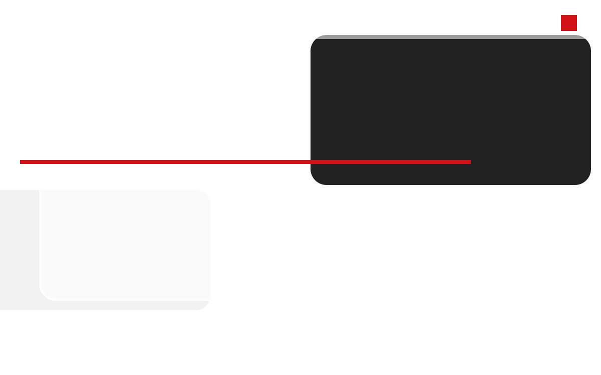

# CREASE

白底、磨砂但仍然很黑的亚克力、红只做细线。这是一套可复用的页面设计，不是某个产品的皮肤。

## 用什么

- 主题变量：[src/theme/crease.css](src/theme/crease.css)，按 shadcn 的名字写。`primary` 是黑。`signal` 是红，只用于 1px 线和点。
- 组件：[src/components/crease/ui.tsx](src/components/crease/ui.tsx)：`Button`、`Field`、`TextArea`、`Card`、`FigureCard`、`Stat`、`DataRow`、`Switch`、`Empty`、`PageHeader`。
- 页面模板在 [src/components/crease/templates.tsx](src/components/crease/templates.tsx)、[src/components/crease/app-pages.tsx](src/components/crease/app-pages.tsx) 和 [src/components/crease/pages](src/components/crease/pages)。

覆盖的页面：组件、文章、表单、图库、管理首页、订单、用户、登录、手机订单、商品、结算、设置、通知、来源。

## 灵感来源

视觉方法来自《镜之边缘》，不是素材引用。本仓库的标志、[public/sources/red-line.svg](public/sources/red-line.svg) 和分享图都是原创。没有游戏截图、角色、标志或官方宣传图。

引用图：

这张图按同一方法重画：白底、一块仍很黑的亚克力、一条红线、一个红点。它说明方法，不代替游戏画面。

### Mirror's Edge（2008）

- 开发：DICE。发行：Electronic Arts。
- 美术指导：Johannes Söderqvist。
- 取用的方法：环境保持白和干净；红用来标路，不铺成界面。CREASE 把红再收成细线、红点和切口，按钮保持黑色。
- 出处：[IGN，Artist in Residence: Mirror's Edge](https://www.ign.com/articles/2008/11/13/artist-in-residence-mirrors-edge)。Söderqvist 说明红色是 runner vision，白几何和冷色天空把暖色衬出来。

### Mirror's Edge Catalyst（2016）

- 开发：DICE。发行：Electronic Arts。
- 美术指导：Jhony Ljungstedt。
- 取用的方法：城市被收成必要的白色体块，细节能减则减。
- 出处：[80 Level，EA DICE 谈 Glass 城](https://80.lv/articles/ea-dices-artists-talk-building-the-world-of-mirrors-edge-catalyst)。

游戏名称和上述文章标题归原权利人。这里只链到公开访谈，不转载游戏画面。
